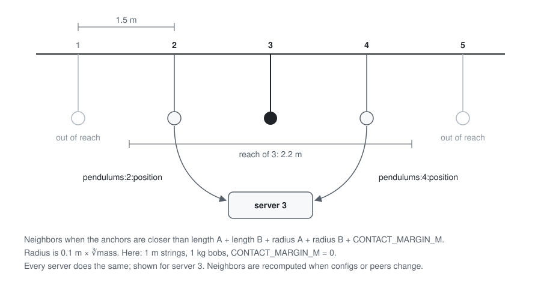

# Distributed pendulums

Each pendulum runs in its own Node.js server. The servers use Redis to stop together when two bobs collide, then restart together. A React UI shows the pendulums live and lets you start and stop the simulation or edit individual pendulums.

## Setup

### Quick start

You need Docker.

```sh
docker compose up --build
```

This starts Redis, the gateway, the UI and five pendulum servers. Open http://localhost:5173 and press Start. The first collision happens after about a second. All pendulums stop, wait 5 seconds, then reset and swing again.

- Another number of pendulums: `docker compose up --build --scale pendulum=N`. Each new server gets the next id from a Redis counter and a default config based on that id: anchor at id × 0.7 m, strings alternating 1 m and 0.6 m. It starts stopped. The UI shows any number of pendulums, and Start is refused if a newcomer's bob would initially overlap another.
- Other ports: set `UI_PORT` (default 5173) and `GATEWAY_PORT` (default 8080) in the environment or in a `.env` file next to `compose.yaml`.
- Stop everything: `docker compose down`.

### Development without Docker

You need Node 24. Redis still runs in Docker. Run each `dev` command in its own terminal, repeating the pendulum command for each server.

```sh
npm install
npm run dev:redis
npm run dev -w @pendulums/pendulum
npm run dev -w @pendulums/gateway
npm run dev -w @pendulums/ui
```

To send commands without the UI, use `npm run bus -w @pendulums/pendulum -- send start` (also `pause` and `stop`). To print decoded bus messages, use `npm run bus -w @pendulums/pendulum -- watch`. After changing a `.proto` file, run `npm run generate`.

### Running the tests

You need Node 24 and `npm install`. Docker and Redis aren't needed.

```sh
npm test
npm run typecheck
npm run lint -w @pendulums/ui
```

The tests cover physics, collision and neighbor detection, the state machine, a five-server collision cycle, the gateway API through Connect's in-memory transport, and UI components in jsdom with a fake `SimulationService`.

The five-server tests use an in-memory bus and fake timers. They cover a full cycle, two servers reporting the same collision, a lost RESTART, a server missing STOP, a server dying mid-cycle, and a user stopping the simulation during the wait. There is no automated test against real Redis.

## Architecture


Servers never call each other. They only talk to Redis, using binary protobuf messages generated from the same `.proto` files as the API.

The gateway keeps the latest state of every pendulum in memory. It accepts config changes only when the simulation is stopped, values are in range, and no bobs would start on top of each other. It also refuses Start if two bobs would initially overlap. Pause and Stop are broadcast as they are.

### The collision cycle

Two bobs touch when the distance between their centers is less than the sum of their radii. Mass only affects bob size: the radius is 0.1 m times the cube root of the mass in kg. The check lives in `isTouching` in `packages/shared/src/geometry.ts`.

Messages from older cycles are ignored. A server that missed STOP catches up when it receives a RESTART, READY or heartbeat with a newer cycle number. Lost RESTART and READY messages are resent every second. A peer already running again in the same cycle counts as having sent both messages. A server that missed an entire cycle adopts its number and restarts.


### Repo layout

- `proto/`: the protobuf contract for shared types, bus messages and the public API.
- `packages/shared`: generated code, channel names, config validation, bob geometry, the `Bus` interface, the Redis adapter, and an in-memory bus for tests.
- `packages/pendulum`: the pendulum server, with physics, collision checks, the state machine and the collision cycle.
- `packages/gateway`: the Connect API and its view of the system, built from bus traffic.
- `packages/ui`: the React app, which draws the pendulums as SVG in meters.

## Decisions and trade-offs

I chose Redis pub/sub over direct server calls or a central coordinator. Each server only needs to know Redis, broadcasting takes one publish, and adding a server changes nothing else. Direct calls would require servers to know each other, while a coordinator would hold all the logic. Redis adds another container, doesn't store messages, and is a single point of failure.

I added a READY round after RESTART because receiving every RESTART only tells one server it can proceed, not that the others have received theirs. Each server sends READY once it has every RESTART it expects, then starts the 5 s countdown after receiving READY from every participant. This works as long as the servers share the same membership view. It adds one message type and phase. Cycle numbers handle duplicates, late messages and two servers detecting the same collision.

For collision detection, each server subscribes only to the position channels of pendulums within reach. Two bobs can only touch if their anchors are closer than the sum of both string lengths and both radii. This also catches a long pendulum that can swing past the one next to it. At 50 servers, a single shared position channel would produce about 147,000 deliveries a second (calculated). If every pendulum can reach every other, traffic is still quadratic. Config and peer changes also mean updating subscriptions.



At the start of each collision cycle, every server takes a snapshot of the peers it heard from in the last 5 s, excluding stopped ones. Late joiners don't participate. If a participant goes silent for 5 s, the others drop it rather than wait indefinitely. I chose progress over strict agreement here. Heartbeats can arrive at different times, so two servers may start with different member lists. Each waits only for its own list, and their restarts can end up a few seconds apart.

For the UI, I use one `WatchPendulums` stream over the Connect protocol, with JSON over HTTP. The browser receives every pendulum's state every 50 ms. That interval stays fixed as N grows, but each snapshot gets larger. The bus and API share one protobuf schema, with generated types on both ends. This requires a codegen step.

The simulation advances in fixed 1/60 s steps. I update the speed first, then the position (semi-implicit Euler). This avoids the steady energy gain of plain Euler, which updates both from the old values. In a 10,000-step test, the energy varies by less than 3% within a swing, and that variation is the same at the end as at the start. Plain Euler gains more than ten times its energy over the same run. If the timer falls more than five steps behind, I run five steps and drop the rest. The simulation then falls behind real time rather than racing to catch up.

I keep Redis behind a small `Bus` interface. Server logic uses `Bus` rather than Redis directly, so tests can swap in an in-memory bus with fake timers. A 10-second scenario then runs in milliseconds.

Randomize applies valid random values immediately, making collisions quick to trigger. Manual edits are different: Start stays blocked until the user applies or resets them. It takes one more click, but Start never sends values the user didn't apply.

I left out the wind bonus to spend the time on the distributed logic and the UI.

## Known limitations

- Redis is a single point of failure, and pub/sub doesn't store messages. During an outage, servers keep swinging but can't coordinate, and UI commands fail with UNAVAILABLE. Servers resubscribe when Redis returns. I checked this against a real Redis.
- Publishing has no deadline. If Redis stalls while the connection stays open, commands hang instead of failing with UNAVAILABLE.
- Ids aren't recycled, so they keep growing until Redis restarts, for example on `docker compose down`. If Redis restarts while servers are running, the counter resets and a new server can receive a live server's id. Past id 28, the default anchor falls outside the allowed ±20 m.
- A server stalled for more than 5 seconds is dropped from a cycle. The others restart without it.
- After a server crashes, its neighbors keep its last position for up to 5 seconds. This can cause a phantom collision.
- The 5-second restart timers start a few milliseconds apart, not at exactly the same time.
- A server that missed STOP can restart a few seconds after the others.
- Collisions are checked once per tick, so two fast bobs could pass through each other between ticks. Strings aren't checked.
- Every server receives every heartbeat, so heartbeat traffic grows with the square of N: 1,900 deliveries a second at 20 servers (calculated).
- There is only one gateway. If it stops, the UI loses its view, but the simulation keeps running.
- Containers run TypeScript with tsx, so the images include dev dependencies.
- Containers have no restart policies.
- There is no authentication, and CORS allows any origin by default.

## Things I found while building it

- I checked real Redis traffic against my estimate. Each server publishes its position 60 times a second and a heartbeat 5 times a second, so I expected 65 Redis commands a second per server, or about 1,300 with 20 servers. I ran 20 pendulum servers in Docker on one Apple Silicon Mac and measured for 10 seconds. Redis handled 1,378 commands a second. Redis used 15.6% CPU, the gateway 7.6%, and each pendulum server 4.6% CPU and 140 MiB of memory. This shows the system runs beyond five servers on one machine, but not where it stops scaling.
- The restart timers fire milliseconds apart. At first, a server that restarted early would see its neighbor still frozen at the collision point and report another collision. I fixed this by adding the sender's phase to position messages. Only running bobs now count.

## On AI usage

To be transparent, I used Claude Code to write the code, guided by my own prompts and design decisions. I reviewed every diff before committing and rejected or reworked changes that didn't fit the design.

I also asked a second AI model and a cloud review to look for bugs. The second model found a stream leaking one listener per snapshot, a late cycle joiner that could wait forever, and publish failures reported as success. I fixed all three, along with four bugs from the cloud review. Each fix has a regression test that fails on the old code. Three other cloud review findings are listed under known limitations.
