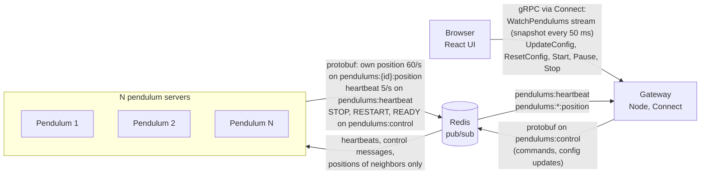

# Distributed pendulums

A pendulum simulation where every pendulum runs in its own server process, and the servers coordinate over Redis to stop together on a collision and restart together. A React UI shows the pendulums live, starts and stops the simulation, and edits each pendulum's settings.

Randomize applies a valid random configuration right away, which makes it quick to trigger and watch the collision cycle. Manual edits must be applied or reset before Start.

## Quick start

The only prerequisite is Docker.

```sh
docker compose up --build
```

Open http://localhost:5173 and press Start. About a second later, two neighboring bobs touch. Every pendulum freezes, the bobs turn amber, and a striped band counts down 5 seconds. Then every pendulum resets to its starting angle and swings again, so the cycle repeats.

- More or fewer pendulums: `docker compose up --build --scale pendulum=7`. Nothing else changes.
- Other ports: set `UI_PORT` (default 5173) and `GATEWAY_PORT` (default 8080) in the environment or in a `.env` file next to `compose.yaml`.
- Stop everything: `docker compose down`.

## Architecture



Each pendulum server runs the physics at 60 steps a second and publishes its bob position on its own channel. Five times a second it publishes a heartbeat with its id, config, phase and cycle number. Servers never call each other. They only know Redis. The gateway listens to the same traffic, keeps the latest state of every pendulum in memory, and streams a snapshot to each browser every 50 ms. Commands from the UI are validated in the gateway and broadcast on the control channel. All messages on Redis are binary protobuf, from the same `.proto` files as the API.

### The collision cycle

Two bobs touch when their centers are closer than their radii added together, where a radius is 0.1 m times the cube root of the mass in kg. `CONTACT_MARGIN_M` in `packages/shared/src/geometry.ts` adds a margin to that distance and is 0 today.

1. A server sees its bob start touching a neighbor's bob. It sends STOP with the next cycle number.
2. Every server freezes, writes down which peers are alive right now (its participants for this cycle), and sends RESTART.
3. Once a server has RESTART from every participant, it sends READY: "I have heard from everyone."
4. Once it has READY from every participant, it knows every server has every RESTART. It waits 5 seconds.
5. It resets to its configured starting angle and runs again.

RESTART and READY are resent every second until the cycle ends. Messages from an older cycle are ignored. A user Stop cancels the cycle at any point.

### Repo layout

- `proto/`: the protobuf contract. Shared types, internal bus messages, and the public API, in three files.
- `packages/shared`: generated protobuf code, channel names, config validation, bob geometry, the `Bus` interface, the Redis adapter, and an in-memory bus for tests.
- `packages/pendulum`: the pendulum server. Physics, collision checks, the state machine and the collision cycle.
- `packages/gateway`: the Connect service the browser calls, and its view of the system built from bus traffic.
- `packages/ui`: the React app. Draws the pendulums as SVG in meters.

## Decisions and trade-offs

**Redis pub/sub between servers.** I chose a shared broker over direct server-to-server calls and over a central coordinator. With direct calls, every server needs a list of every other server, and adding one means changing all of them. A coordinator would hold all the logic, and the pendulums would stop being independent. With pub/sub, a server only knows Redis, and "tell everyone" is one publish, so adding a server changes nothing else. The cost: Redis is one more container and a single point of failure, and pub/sub doesn't store messages.

**Two rounds with a cycle number.** The task says each pendulum waits until all instances have received RESTART from all others. Collecting RESTART from everyone only proves that I have them all. The READY round proves that everyone else does too. It looks like two-phase commit, but nothing is saved or rolled back. It's a barrier. The cycle number makes duplicates and late messages harmless, and two servers that detect the same collision at the same moment send the same number, so it stays one cycle. The cost is one more message type and phase.

**Neighbors are the pendulums within reach.** A bob is never further from its anchor than its string length. So if two anchors are further apart than both strings plus both radii, those bobs can never touch. Everyone closer is a neighbor, including a long pendulum that can swing past the one next to it. Each server subscribes only to its neighbors' position channels. My first plan sent every position on one shared channel to every server. When I counted messages, each server's intake grew with the total and Redis traffic grew with the square of it. At 50 servers, my first design would have needed about 147,000 message deliveries a second (calculated, not measured), for each server to check two neighbors. The cost of the fix is resubscribing when neighbors change, which only happens while stopped or when servers join or leave.

**Membership from heartbeats, frozen at STOP.** When a cycle starts, each server takes a snapshot of every peer heard from in the last 5 seconds. Servers that join later don't change who it waits for. A participant silent for 5 seconds is dropped, and the rest finish without it. This is a choice between safety and progress: wait forever for a server that might be dead, or move on without it. I chose progress after 5 seconds.

**A gateway that streams snapshots over gRPC with Connect.** The browser opens one `WatchPendulums` stream and gets a full snapshot every 50 ms, whatever the number of servers. Servers simulate at 60 Hz and the UI draws at 20 snapshots a second, so the two rates are independent. REST would also work for six calls. I chose gRPC for one schema across the bus and the API, generated types on both ends, and streaming without a second technology. I also wanted to learn it. Connect serves it to the browser without a proxy. The cost is a codegen step and an API you can't call with plain curl.

**Testable core.** Physics advances by a fixed 1/60 s step with semi-implicit Euler. Updating the speed before the angle keeps energy steady; plain Euler adds energy every step. If a timer fires late, the loop runs extra steps to catch up, capped at five. The physics step is a pure function, and all server logic talks to a small `Bus` interface instead of Redis. In production a Redis adapter implements it. In tests an in-memory fake does, with fake timers, so a 10-second scenario runs in milliseconds.

I deliberately left out the wind bonus. I spent the time on the distributed logic and the UI.

## Measurements

20 pendulums running in Docker on one Apple Silicon Mac, measured over 10 seconds:

| Container | CPU | Memory |
|---|---|---|
| Redis | 15.6% | 12.0 MiB |
| Gateway | 7.6% | 141.4 MiB |
| One pendulum server | 4.6% | 139.8 MiB |

20 servers each publish about 65 messages a second (60 positions + 5 heartbeats), about 1,300 a second in total by calculation, which matches the measured 1,378 Redis commands a second. Publishes to Redis grow linearly with the number of servers. Position deliveries stay roughly constant per server, because each one listens only to the pendulums within reach. Heartbeat deliveries grow with the square of the number of servers, because every server hears every heartbeat. At 20 servers that is 20 × 19 × 5 = 1,900 deliveries a second (calculated, not measured). That is small, but it is quadratic.

## Known limitations

- Redis is a single point of failure, and pub/sub doesn't store messages. If Redis goes down, servers keep swinging but can't coordinate.
- If Redis goes down, commands from the UI fail with an "unavailable" error instead of reporting success. Positions and heartbeats are dropped rather than queued, and the servers reconnect and resubscribe on their own when Redis is back. I verified this on a real Redis: Start answered "unavailable" in about half a second while Redis was down, and after Redis came back the next collision cycle ran normally.
- A server stalled for more than 5 seconds is dropped from a cycle, and the others restart without it.
- The 5-second restart timers start a few milliseconds apart, not at the same instant.
- A server that missed a STOP joins through heartbeats, and it can restart up to a few seconds after the others.
- Collisions are checked once per tick, so two fast bobs could pass through each other between ticks. Strings aren't checked at all.
- Heartbeats still reach every server, so heartbeat traffic grows with the square of N. At 5 small messages a second this is negligible at this scale.
- There is one gateway. If it stops, the UI loses its view, but the simulation keeps running.
- A new server starts stopped and waits for the next Start.
- Containers run TypeScript with tsx, so the images include dev dependencies.
- There is no end-to-end test against real Redis.

## Things I found while building it

My first energy test assumed the energy would barely move, and it failed at about 2.5%. I measured over 100,000 steps and the wobble never grew: it rises and falls within each swing and comes back. So the test now checks what matters, that the wobble is the same after three minutes as at the start.

The test for a server dying mid-cycle failed, but the bug was in my fake bus. It picked the receivers when a message was sent, so a message already in flight still reached a server after it died. A dead process gets nothing, so the fake now checks again on arrival.

The restart timers fire a few milliseconds apart. A server that restarted first could see its neighbor still frozen at the collision spot and report a new collision at once. I added the sender's phase to the position message, and only running bobs count.

Screenshots of the UI against the real stack showed three issues. The collision band covered the pendulum numbers, a hidden accessibility label made the page scroll sideways on phones, and the angle error came back in radians while the form uses degrees. All three are fixed.

I asked for an independent code review from a different AI model than the one I built with. It found a stream that leaked one listener per snapshot, a rare case where a server that joined a cycle late could wait forever, and that publish failures were reported as success. Each fix has a test that fails on the old code.

## Running the tests

You need Node 24. Docker and Redis aren't needed.

```sh
npm install
npm test
npm run typecheck
```

There are 111 tests in 16 files. They cover the physics, collisions and neighbors, the state machine, a five-server collision cycle on an in-memory bus with fake timers, the gateway API through Connect's in-memory transport, and the UI's pure helpers. The five-server test covers a full cycle, two servers reporting the same collision, a lost RESTART, a server that missed the STOP, a server dying mid-cycle, and a user stop during the wait.

The UI component tests run in jsdom with Testing Library against the real Connect client and an in-memory fake `SimulationService`. They cover the configuration table (edit, Apply, Reset, locking while running, Randomize applying in order), Start blocked by unapplied edits, Pause and Stop, the stage (bobs, collision status, zoom) and the app showing a streamed snapshot.

## Development without Docker

Start Redis with its port published, then run each piece in its own terminal:

```sh
npm run dev:redis
npm run dev -w @pendulums/pendulum   # once per pendulum server
npm run dev -w @pendulums/gateway
npm run dev -w @pendulums/ui
```

To talk to the bus without the UI, `npm run bus -w @pendulums/pendulum -- send start` sends a command (also `pause` and `stop`), and `npm run bus -w @pendulums/pendulum -- watch` prints decoded messages. After changing a `.proto` file, run `npm run generate`.

## What I'd do next

- An end-to-end test that runs real servers against real Redis through a full collision cycle.
- nginx proxying the API on the same origin as the UI, which removes CORS and the gateway URL baked into the build.
- Compiled production images with only runtime dependencies.
- A small Playwright suite for layout checks against the running stack.
- Wind, as one more term in the physics step and one more broadcast setting.
